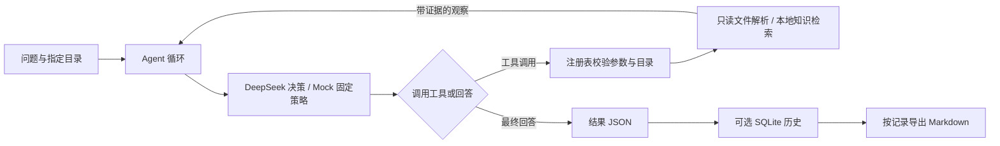

# VASP-Copilot

**只读 VASP 日志诊断 Agent · Read-only VASP diagnostics agent**

从计算目录提取可追溯的文件证据，用本地知识笔记解释观察结果，并通过 DeepSeek 工具调用生成中文回答。适合初步检查日志、核对输入与输出、整理诊断记录，也适合学习“解析器 → 工具 → Agent → 历史与报告”的实现。

## 已实现能力

- 检查 `INCAR`、`POSCAR`、`KPOINTS`、`POTCAR`、`OUTCAR`、`OSZICAR`、`CONTCAR`、`vasprun.xml` 八个文件的存在性与可读取性；可读不表示完整或有效。
- 解析 INCAR 显式 `IBRION` / `NSW`，提取 OUTCAR 前缀中的对应参数并核对；从 OUTCAR 尾部观察消息和最后可关联的迭代，保留原文与位置。
- 观察 OUTCAR 中的 `EDIFF`、`NELM`、`ICHARG`、`ALGO`、`IALGO` 五项设置，区分已观察、缺失与歧义，不补默认值。
- 在可靠关联的最后采样电子循环明确报告未达 EDIFF 时给出局部 `reported_not_reached` 警告及人工核查建议；不据此推断根因或整次计算失败。
- 解析 OSZICAR 常见电子行与能量摘要，比较两份输出中最后保留的离子/电子步编号；编号相同不证明同次运行或收敛。
- 关键词检索八篇本地知识笔记，区分“官方资料摘要”与“项目限制”；支持 SQLite 保存完整 Agent 过程及 Markdown 报告导出。

## Agent 如何工作



不加 `--agent` 时直接扫描，不调用模型。`--agent` 默认使用离线 Mock；Mock 是验证执行机制的固定条件策略，不理解自然语言问题。显式选择 `--backend deepseek` 才进行真实模型调用。

## 安装

需要 **Python 3.10+**。下载或克隆仓库，进入包含 `pyproject.toml` 的项目根目录后执行；依赖安装可能需要联网。无需依赖开发者机器上的环境或 `PYTHONPATH`。

```bash
git clone https://github.com/BerlinY5/vasp-copilot.git
cd vasp-copilot
```

Windows PowerShell：

```powershell
python -m venv .venv
.\.venv\Scripts\python.exe -m pip install -e '.[test]'
```

Linux / macOS：

```bash
python -m venv .venv
.venv/bin/python -m pip install -e '.[test]'
```

以下命令在项目根目录执行，采用 Windows PowerShell 写法；Linux / macOS 将 `.\.venv\Scripts\python.exe` 替换为 `.venv/bin/python`。

## 用公开样例开始

```powershell
python examples/prepare_demo.py
.\.venv\Scripts\python.exe -m vasp_copilot data/local/demo/static_silicon
```

准备脚本只原样解压/复制仓库内附许可的 fixtures 到 `data/local/demo/static_silicon`，不联网，不覆盖内容不同的已有文件。样例是公开静态硅输出日志，其他计算文件缺失属于预期；来源与哈希见 [fixtures 说明](tests/fixtures/pymatgen/README.md) 和 [清单](tests/fixtures/pymatgen/manifest.json)。

离线试跑 Agent：

```powershell
.\.venv\Scripts\python.exe -m vasp_copilot data/local/demo/static_silicon --agent --max-steps 8
```

## 使用真实 DeepSeek

项目只读取进程环境变量，**不自动加载 `.env`**；[`.env.example`](.env.example) 仅列出配置字段。PowerShell 隐藏输入密钥，不在命令中写明密钥：

```powershell
$env:DEEPSEEK_API_KEY = ([System.Net.NetworkCredential]::new('', (Read-Host 'DeepSeek API Key' -AsSecureString))).Password
$run = .\.venv\Scripts\python.exe -m vasp_copilot data/local/demo/static_silicon --agent --backend deepseek --question '请简洁检查日志，检索相关解释，分别列出文件证据、参考来源和未知事项。' --max-steps 8 --progress --require-knowledge --save-history | ConvertFrom-Json
$run | Format-List status, decision_steps, answer, error, history_record
```

这会向 DeepSeek 发送问题、目录路径、工具说明及工具返回的采样证据，并产生实际 API 用量。默认模型以 [`config.py`](src/vasp_copilot/config.py) 为准，可通过 `DEEPSEEK_MODEL` 配置；`DEEPSEEK_TIMEOUT` 可配置网络操作超时。完整说明见 [DeepSeek 配置与排错](docs/deepseek.md)。

`--progress` 把阶段进度写入 stderr，stdout 仍是最终 JSON；不要合并两者再解析。`--require-knowledge` 要求成功执行本地检索后才接受回答，允许零命中，不保证回答正确。`--max-steps` 限制决策次数，含最终回答；它不是总运行时限。`completed` 表示完成回答，工具 `success` 表示产生合法结果，都不表示 VASP 已收敛。

历史默认保存到 `data/local/diagnostics.sqlite3`，请确认 `history_record.status` 为 `saved`。运行后可查看和导出记录，编号应替换为实际 `run_id`：

```powershell
.\.venv\Scripts\python.exe -m vasp_copilot --history --limit 5
.\.venv\Scripts\python.exe -m vasp_copilot --show-run 1
.\.venv\Scripts\python.exe -m vasp_copilot --export-run 1
Remove-Item Env:DEEPSEEK_API_KEY
```

查询和导出不调用模型、不重新读取计算目录。报告默认写入 `reports/generated/run-1.md`，已有报告不覆盖。详见 [诊断历史](docs/history.md) 与 [报告导出](docs/reports.md)。

## 七个工具

| 工具 | 用途 |
| --- | --- |
| `scan_directory` | 综合扫描，包含文件、参数、日志观察与跨文件比较 |
| `inspect_directory` | 只检查八个已知文件的存在性与可读性 |
| `diagnose_outcar` | OUTCAR 尾部消息、最后迭代、五项电子设置和局部警告 |
| `inspect_incar` | 读取显式 IBRION / NSW 与输入意图 |
| `inspect_oszicar` | 读取尾部电子行和能量摘要 |
| `compare_outputs` | 核对 OUTCAR / OSZICAR 最后采样步编号 |
| `search_knowledge` | 检索随包分发的八篇关键词知识笔记，不联网 |

## 目录

| 路径 | 内容 |
| --- | --- |
| `src/vasp_copilot/` | CLI、数据契约和只读解析器 |
| `src/vasp_copilot/agent/` | 工具注册、决策循环、Mock 与 DeepSeek 后端 |
| `src/vasp_copilot/tools/`、`src/vasp_copilot/rag/` | 七个工具入口与本地知识检索 |
| `src/vasp_copilot/storage/`、`src/vasp_copilot/reports/` | SQLite 历史与 Markdown 生成 |
| `examples/` | 公开演示样例准备脚本 |
| `tests/` | 离线测试与附来源、许可、哈希的 fixtures |
| `docs/` | 架构、规则、使用方式与验证边界 |
| `data/local/`、`reports/generated/` | 本地数据与生成报告，不纳入发布 |

## 测试与离线评估

```powershell
.\.venv\Scripts\python.exe -m pytest -q
.\.venv\Scripts\python.exe -m vasp_copilot.evaluation
```

测试和评估使用本地 fixtures、临时目录及模拟模型传输，不需要 API Key、不调用真实模型。评估先核验样例哈希，检查当前 Mock 策略、工具证据及 `unknown` 边界；它不是 DeepSeek 准确率或科学计算成功率。详见 [评估说明](docs/evaluation.md)。

## 当前范围与来源

这是有限读取、保留证据的初步诊断工具。整体终止状态、整体电子收敛和离子收敛仍为 `unknown`；未发现消息不代表失败，看到消息也不等于独立重算了收敛判据。参数比较不确认文件归属，前缀设置与尾部循环的运行关联仍未验证。工具不执行 VASP、不提交作业、不修改计算文件。

公开回归样例来自 pymatgen 固定提交，包含 VASP 5.2.12 的有限日志；项目没有覆盖所有 VASP 版本、计算模式或真实 SCF 故障。第 14 条在线记录是一次真实 DeepSeek 调用，但使用人工变换的消息案例，只验证该案例的参数读取和解释边界；历史记录见 [在线验证](docs/online-validation.md)，原始本地数据库不公开。

知识笔记是项目对官方资料的摘要与自身规则说明，不是官方全文，也不会在运行时访问来源网页。第三方样例许可见 [`LICENSE.pymatgen`](tests/fixtures/pymatgen/LICENSE.pymatgen)，MIT 仅覆盖相应 fixtures；项目代码的根许可尚待作者选择。

## 建议学习顺序

运行公开样例 → CLI 入口 → 数据协议与工具注册 → Agent 循环 → DeepSeek 适配 → 文件诊断与检索 → 历史与报告。
具体文件、练习及对应测试见 [代码学习路线](docs/learning.md)，全部文档入口见 [文档导航](docs/index.md)。
