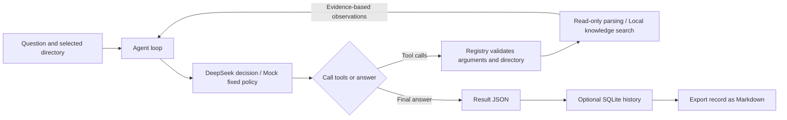

# VASP-Copilot

**Read-only VASP diagnostics agent**

Extract traceable file evidence from a calculation directory, explain observations using local English knowledge notes, and generate English answers by default through DeepSeek tool calls, unless the user explicitly requests another language. Useful for initial log inspection, input/output checks, diagnostic records, and learning the implementation from “parser → tools → Agent → history and reports.”

## Implemented capabilities

- Check whether eight files exist and are readable: `INCAR`, `POSCAR`, `KPOINTS`, `POTCAR`, `OUTCAR`, `OSZICAR`, `CONTCAR`, and `vasprun.xml`. Readability does not establish completeness or validity.
- Parse explicit INCAR `IBRION` / `NSW`, extract the corresponding parameters from the OUTCAR prefix, and compare them; observe messages and the last associable iteration in the OUTCAR tail, preserving original text and positions.
- Observe five OUTCAR settings: `EDIFF`, `NELM`, `ICHARG`, `ALGO`, and `IALGO`. Distinguish observed, missing, and ambiguous values without filling in defaults.
- When the last reliably associated sampled electronic loop explicitly reports that EDIFF was not reached, provide a local `reported_not_reached` warning and suggestions for manual checks, without inferring a root cause or failure of the entire calculation.
- Parse common OSZICAR electronic lines and energy summaries, and compare the last retained ionic/electronic step numbers in the two outputs. Equal numbers do not establish a shared run or convergence.
- Search eight local English knowledge notes by keyword, distinguishing “Official-source summary” from “Project policy”; save complete Agent runs in SQLite and export Markdown reports.

## How the Agent works



Without `--agent`, the program scans directly and does not call a model. `--agent` defaults to the offline Mock test backend: its fixed conditional policy tests the execution mechanism and does not understand natural-language questions. Real model calls require explicitly choosing `--backend deepseek`.

## Installation

Requires **Python 3.10+**. Download or clone the repository, enter the project root containing `pyproject.toml`, and run the following commands. Installing dependencies may require internet access. No environment or `PYTHONPATH` from the developer's computer is required.

```bash
git clone https://github.com/BerlinY5/vasp-copilot.git
cd vasp-copilot
```

Windows PowerShell:

```powershell
python -m venv .venv
.\.venv\Scripts\python.exe -m pip install -e '.[test]'
```

Linux / macOS:

```bash
python -m venv .venv
.venv/bin/python -m pip install -e '.[test]'
```

The commands below run from the project root and use Windows PowerShell syntax; on Linux / macOS, replace `.\.venv\Scripts\python.exe` with `.venv/bin/python`.

## Start with the public sample

```powershell
python examples/prepare_demo.py
.\.venv\Scripts\python.exe -m vasp_copilot data/local/demo/static_silicon
```

The preparation script only decompresses/copies the licensed fixtures bundled in the repository to `data/local/demo/static_silicon`, preserving their contents. It makes no network requests and does not overwrite existing files with different contents. The sample contains public static-silicon output logs; other calculation files are expected to be missing. See the [fixture notes](tests/fixtures/pymatgen/README.md) and [manifest](tests/fixtures/pymatgen/manifest.json) for sources and hashes.

Try the Agent offline:

```powershell
.\.venv\Scripts\python.exe -m vasp_copilot data/local/demo/static_silicon --agent --max-steps 8
```

## Use real DeepSeek calls

The project reads only process environment variables and **does not automatically load `.env`**; [`.env.example`](.env.example) only lists configuration fields. Enter the key through a hidden PowerShell prompt instead of placing it in the command:

```powershell
$env:DEEPSEEK_API_KEY = ([System.Net.NetworkCredential]::new('', (Read-Host 'DeepSeek API Key' -AsSecureString))).Password
$run = .\.venv\Scripts\python.exe -m vasp_copilot data/local/demo/static_silicon --agent --backend deepseek --question 'Briefly inspect the logs, retrieve relevant explanations, and list file evidence, reference sources, and unknowns separately.' --max-steps 8 --progress --require-knowledge --save-history | ConvertFrom-Json
$run | Format-List status, decision_steps, answer, error, history_record
```

This sends the question, directory path, tool descriptions, and sampled evidence returned by tools to DeepSeek and incurs real API usage. The default model is defined in [`config.py`](src/vasp_copilot/config.py) and can be configured through `DEEPSEEK_MODEL`; `DEEPSEEK_TIMEOUT` configures the network-operation timeout. See [DeepSeek configuration and troubleshooting](docs/deepseek.md) for details.

`--progress` writes stage progress to stderr while stdout remains the final JSON; do not merge the streams before parsing. `--require-knowledge` accepts an answer only after a successful local retrieval, allows zero hits, and does not guarantee answer correctness. `--max-steps` limits decisions, including the final answer; it is not a total run-time limit. `completed` means an answer was produced, and tool `success` means a valid result was produced; neither means VASP converged.

History is saved to `data/local/diagnostics.sqlite3` by default; check that `history_record.status` is `saved`. After running, view and export records, replacing the number with the actual `run_id`:

```powershell
.\.venv\Scripts\python.exe -m vasp_copilot --history --limit 5
.\.venv\Scripts\python.exe -m vasp_copilot --show-run 1
.\.venv\Scripts\python.exe -m vasp_copilot --export-run 1
Remove-Item Env:DEEPSEEK_API_KEY
```

Queries and exports do not call a model or reread the calculation directory. Reports default to `reports/generated/run-1.md` and do not overwrite existing reports. See [Diagnostic history](docs/history.md) and [Report export](docs/reports.md).

## Seven tools

| Tool | Purpose |
| --- | --- |
| `scan_directory` | Combined scan of files, parameters, log observations, and cross-file comparison |
| `inspect_directory` | Check only existence and readability of the eight known files |
| `diagnose_outcar` | OUTCAR tail messages, last iteration, five electronic settings, and local warnings |
| `inspect_incar` | Read explicit IBRION / NSW and input intent |
| `inspect_oszicar` | Read tail electronic lines and energy summaries |
| `compare_outputs` | Compare the last sampled OUTCAR / OSZICAR step numbers |
| `search_knowledge` | Search eight bundled keyword-based knowledge notes without network access |

## Directory layout

| Path | Contents |
| --- | --- |
| `src/vasp_copilot/` | CLI, data contracts, and read-only parsers |
| `src/vasp_copilot/agent/` | Tool registration, decision loop, Mock and DeepSeek backends |
| `src/vasp_copilot/tools/`, `src/vasp_copilot/rag/` | Seven tool entry points and local knowledge retrieval |
| `src/vasp_copilot/storage/`, `src/vasp_copilot/reports/` | SQLite history and Markdown generation |
| `examples/` | Public demo sample preparation script |
| `tests/` | Offline tests and fixtures with sources, licenses, and hashes |
| `docs/` | Architecture, rules, usage, and validation boundaries |
| `data/local/`, `reports/generated/` | Local data and generated reports, excluded from releases |

## Tests and offline evaluation

```powershell
.\.venv\Scripts\python.exe -m pytest -q
.\.venv\Scripts\python.exe -m vasp_copilot.evaluation
```

Tests and evaluation use local fixtures, temporary directories, and simulated model transports. They require no API key and make no real model calls. Evaluation verifies sample hashes first, then checks the current Mock policy, tool evidence, and `unknown` boundaries; it does not measure DeepSeek accuracy or scientific calculation success rates. See [Evaluation notes](docs/evaluation.md).

## Current scope and sources

This is an initial diagnostic tool that reads bounded samples and preserves evidence. Overall termination, overall electronic convergence, and ionic convergence remain `unknown`; missing messages do not imply failure, and observing a message does not independently recompute convergence criteria. Parameter comparison does not establish file identity, and the run association between prefix settings and tail loops remains unverified. The tools do not execute VASP, submit jobs, or modify calculation files.

Public regression samples come from a pinned pymatgen commit and include limited VASP 5.2.12 logs; the project does not cover all VASP versions, calculation modes, or real SCF failures. Online record 14 contains a real DeepSeek call using an artificially transformed message case; it verifies parameter reading and interpretation boundaries for that case only. See [Online validation](docs/online-validation.md) for the historical records; the raw local database is not public.

Knowledge notes contain project summaries of official material and project rules. They are not the full official text, and source pages are not accessed at run time. See [`LICENSE.pymatgen`](tests/fixtures/pymatgen/LICENSE.pymatgen) for the third-party sample license; MIT covers only the corresponding fixtures. The author has not yet selected a root license for the project code.

## Suggested learning order

Run the public sample → CLI entry point → data protocols and tool registration → Agent loop → DeepSeek adapter → file diagnostics and retrieval → history and reports.
See the [Code learning path](docs/learning.md) for specific files, exercises, and related tests, and [Documentation](docs/index.md) for all documents.
